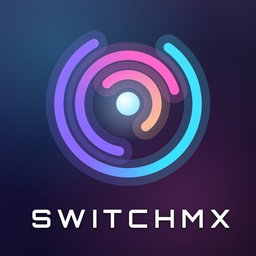
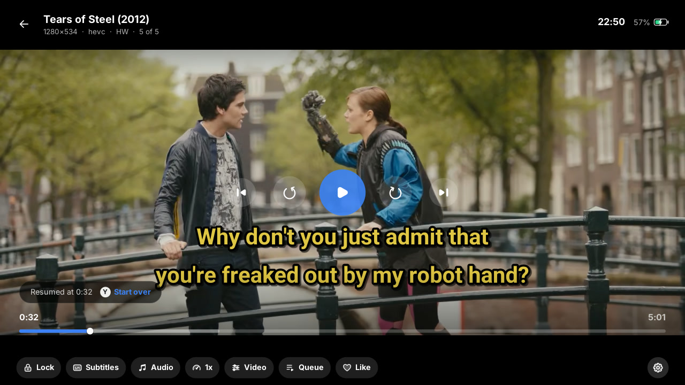
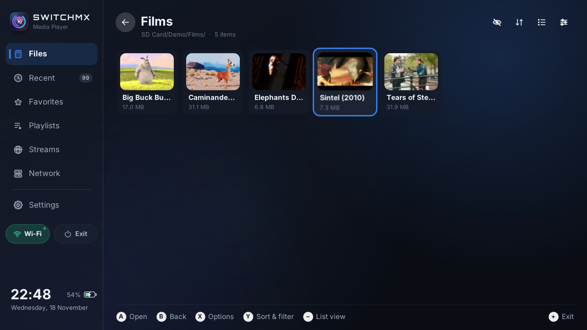
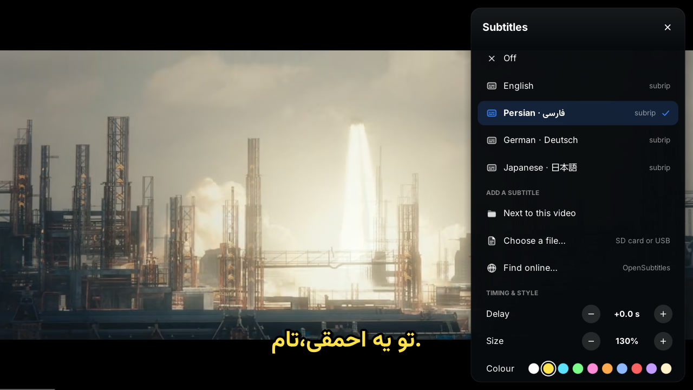
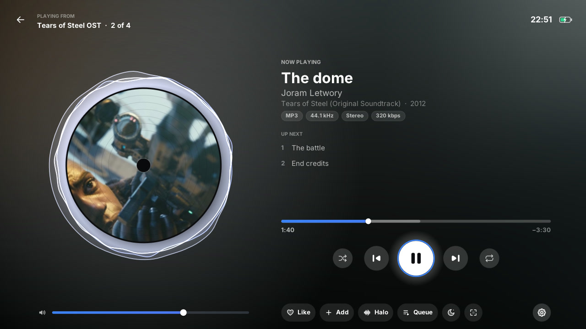
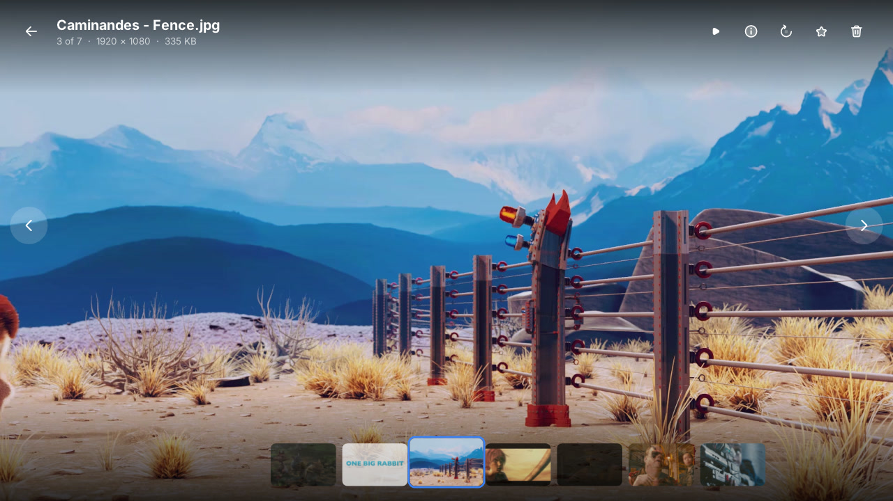
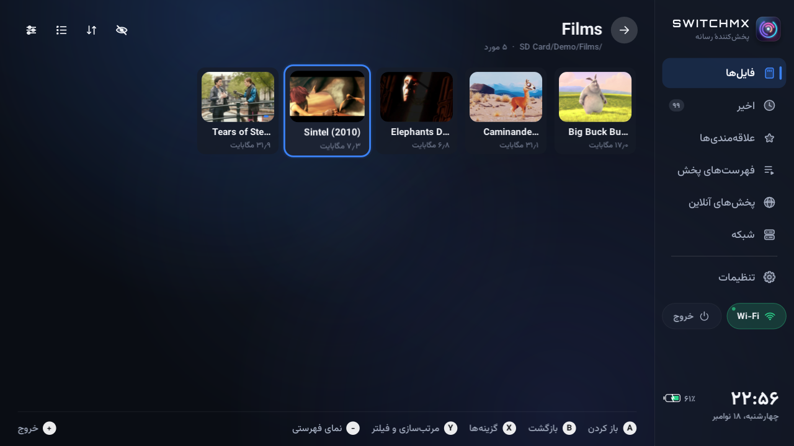
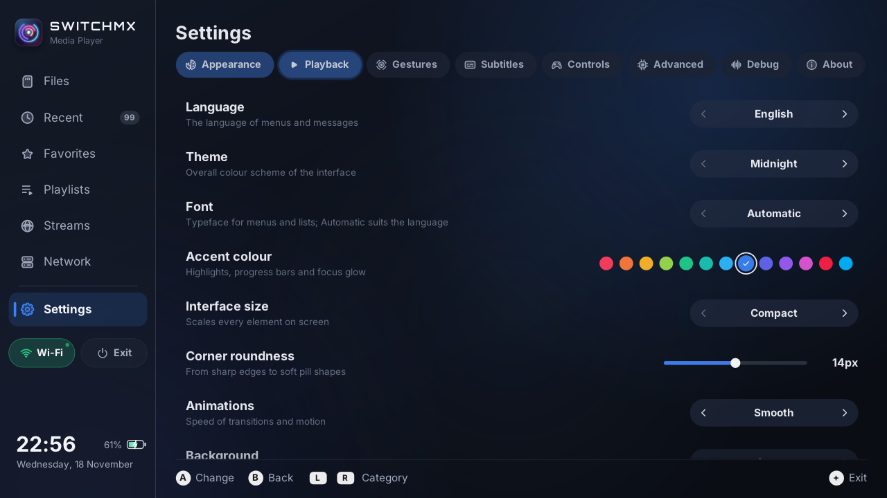
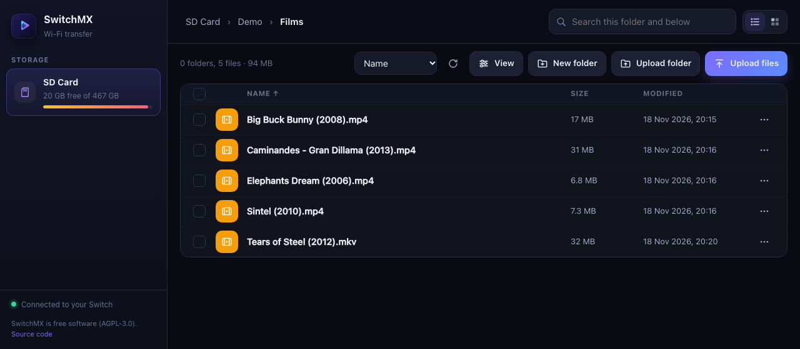

  

<h1 align="center">SwitchMX</h1>

  <b>A modern, touch-first media player for Nintendo Switch homebrew.</b> 
  Films, series, music, live TV, pictures and e-books, in one fast and polished app.

  
  
  

  

## Why SwitchMX

- **Plays almost anything.** Built on mpv and FFmpeg with the Switch's hardware video decoder: H.264, HEVC (including 10-bit and HDR), VP9 and more, up to 4K.
- **Made for the touch screen.** Double-tap to skip, swipe to scrub, brightness and volume on the edges, pinch to zoom, hold to fast-forward. Every button works too.
- **Picks up where you left off.** Resume points for every film, episode and book, with progress rings in the library.
- **More than a video player.** A music player with 18 visualizers, a picture viewer, an e-book and comic reader, IPTV, and network shares.
- **Your language.** 13 languages, including full right-to-left layouts for Persian and Arabic.

## Screenshots

<table>
  <tr>
    <td></td>
    <td></td>
  </tr>
  <tr>
    <td align="center">Library with cover art and watch progress</td>
    <td align="center">Subtitles in any language, styled your way</td>
  </tr>
  <tr>
    <td></td>
    <td></td>
  </tr>
  <tr>
    <td align="center">Music player with live visualizers</td>
    <td align="center">Picture viewer and slideshows</td>
  </tr>
  <tr>
    <td></td>
    <td></td>
  </tr>
  <tr>
    <td align="center">E-books and comics, two pages at a time</td>
    <td align="center">13 languages, right-to-left included</td>
  </tr>
  <tr>
    <td></td>
    <td></td>
  </tr>
  <tr>
    <td align="center">Themes, accent colours and more than 55 options</td>
    <td align="center">Send files from any browser over Wi-Fi</td>
  </tr>
</table>

## What it supports

| | |
|---|---|
| **Video** | MKV, MP4, AVI, WebM, MOV, TS, M2TS, FLV, WMV and more. Hardware decoding for H.264, HEVC, VP8, VP9, VC-1 and MPEG-1/2/4; AV1 in software |
| **Audio** | MP3, FLAC, AAC/M4A, Opus, Ogg, WAV, ALAC, AC-3, DTS, APE, WavPack and dozens more |
| **Subtitles** | SRT, ASS/SSA, PGS, VobSub, WebVTT, built into the file or next to it. Garbled old files in Persian/Arabic, Cyrillic, Greek, Turkish and more are fixed automatically or with one setting. Search OpenSubtitles from the player |
| **Pictures** | JPEG, PNG, WebP, GIF, TIFF, BMP, PSD and more |
| **Books & comics** | EPUB, PDF, MOBI, FB2, CBZ/CBR/CB7, DOCX and plain text |
| **Streams** | HTTP and HTTPS, HLS live TV, RTMP, and M3U/M3U8 IPTV playlists |
| **Network** | SMB (Windows and NAS shares) and FTP, with playback straight from the server |
| **Storage** | SD card plus USB drives formatted FAT32, exFAT, NTFS or EXT2/3/4 |
| **Archives** | Browse and extract ZIP, 7z, RAR and TAR (including password-protected ones), and play media inside them |

### Player

Resume, auto-play the next episode, audio and subtitle tracks, chapters, speed from 0.25× to 3×, A-B loop, sleep timer, zoom and pan, picture adjustments, volume boost to 200%, screenshots and a lock against accidental touches.

### Also included

- **File manager:** copy, move, rename, delete, multi-select, search.
- **Library:** Recent, Favorites, Playlists and saved Streams.
- **Wi-Fi transfer** from any phone or computer, protected by a PIN.
- **Automatic updates** from this page.
- **A HOME Menu icon,** built on your own console.

## Install

1. You need a Switch running custom firmware (Atmosphère) with the Homebrew Menu.
2. Download **`SwitchMX.nro`** from the [latest release](https://github.com/Farzin-Abdi/SwitchMX/releases/latest).
3. Copy it to **`sdmc:/switch/SwitchMX/SwitchMX.nro`** on your SD card.
4. Open it from the Homebrew Menu.

> [!TIP]
> Start the Homebrew Menu by holding **R** while opening any game (title override). SwitchMX then gets the console's full memory, which large or 4K files need. Starting from the Album works too, with less memory.

**Updates:** *Settings → About* checks this page and installs new versions for you.
**HOME Menu icon:** SwitchMX can add its own icon to the HOME Menu (*Settings → Advanced*). The icon is built on your console with your console's own keys; no keys or Nintendo files are included.

<b>Controls</b>

| Touch | Action |
|---|---|
| Tap | Show or hide the controls |
| Double-tap left / right | Skip back / forward (keep tapping to skip more) |
| Swipe sideways | Scrub with a live preview |
| Swipe up or down, left half | Brightness |
| Swipe up or down, right half | Volume |
| Pinch / two-finger drag | Zoom and pan |
| Press and hold | Fast-forward at 1.5×, 2× or 3× |

| Button | Action |
|---|---|
| A | Play / pause |
| B | Show the controls; again to go back |
| ← / → | Seek (faster while held) |
| ↑ / ↓ | Volume, brightness or chapters |
| X, Y, L, R, ZL, ZR | Your choice of 21 actions |
| + / − | Player menu / lock |

Every gesture and button can be changed in *Settings*.

## Building from source

See **[docs/BUILDING.md](docs/BUILDING.md)** for the toolchain, the build steps, a desktop build for quick testing, and a map of the code.

## Credits

Built on [mpv](https://mpv.io), [FFmpeg](https://ffmpeg.org), [libass](https://github.com/libass/libass), [MuPDF](https://mupdf.com), [libarchive](https://libarchive.org), [libsmb2](https://github.com/sahlberg/libsmb2), [libusbhsfs](https://github.com/DarkMatterCore/libusbhsfs), [NanoVG](https://github.com/memononen/nanovg), [libnx](https://github.com/switchbrew/libnx) and [devkitPro](https://devkitpro.org). [THIRD-PARTY.md](THIRD-PARTY.md) lists every component and its licence.

Screenshots show films from the [Blender Foundation](https://studio.blender.org/films/) (*Big Buck Bunny*, *Caminandes*, *Elephants Dream*, *Sintel*, *Tears of Steel*), licensed CC BY 3.0, and music from the *Tears of Steel* soundtrack by Joram Letwory, licensed CC BY-ND 3.0. Book: *Jane Eyre* by Charlotte Brontë (public domain).

Developed by **Farzin Abdi**.

## Licence

SwitchMX is free software under the [GNU Affero General Public License v3.0 or later](LICENSE). No Nintendo code, assets or console keys are included.
